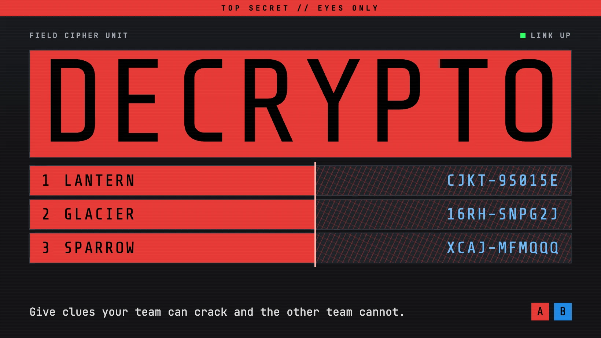

# Decrypto

A multiplayer web implementation of **Decrypto**: two teams, secret keywords, three-digit codes, written clues, interceptions, and miscommunications. It mirrors the architecture of the Just One project — TypeScript everywhere, an Express + Socket.IO server with in-memory rooms, a pure shared game engine, and a mobile-first, installable Vite + React + Tailwind PWA client. There is no database. The live build runs on Fly.io.

## Run locally

Prerequisites: Node.js 20+ and npm.

```bash
npm install
npm run dev
```

That starts:

- **Server** on <http://localhost:3001> (Express + Socket.IO, run with `tsx watch`)
- **Client** on <http://localhost:5173> (Vite dev server)

Open <http://localhost:5173>, create a room, and share the 4-letter room code. The Vite dev server proxies `/socket.io` to the server on port 3001, so the client and server work together without extra configuration.

Useful commands:

```bash
npm test          # engine unit tests (vitest, in shared/)
npm run smoke     # end-to-end socket smoke test on a scratch port (3101)
npm run typecheck # typecheck shared, server, and client
npm run build     # production build of the client (client/dist)
```

You can also run the pieces separately:

```bash
npm run dev --workspace=server   # server only, port 3001
npm run dev --workspace=client   # client only, port 5173
```

## How to play

- Two teams: **Black** and **White**. Join a room, pick a team; the host can start once each team has at least 2 players.
- Each team is dealt **4 secret keywords**, numbered 1–4, visible only to that team. The word bank (`shared/src/words.ts`) has 550+ single-word keywords; the server deals 4 distinct words per team with no overlap between teams.
- A game lasts at most **8 rounds**. Each round, each team has one **Encryptor** (rotating through the team's members). The server draws that team's secret code: **3 distinct digits, each 1–4**.

### Phases each round

1. **Encrypt** — Both Encryptors write 3 clues, one per code position, in parallel. A clue may not be identical to any of their own team's keywords (case-insensitive); the engine rejects it with an error. Submitted clues become public to everyone. The phase advances when both teams have submitted.
2. **Intercept** — *Rounds 2–8 only; skipped entirely in round 1.* Each team works on one shared guess of the **opposing** team's code. Anyone on the team (including their own Encryptor — they're guessing the *other* code) can edit the draft or lock it in.
3. **Decode** — Each team submits one shared guess of **its own** code. The Encryptor may **not** edit or lock this guess (they know the answer); any other team member can.
4. **Reveal** — The server compares guesses to the true codes:
   - A team's interception guess exactly matching the opposing code earns that team **1 Interception token**.
   - A team's own decode guess **not** matching its code earns that team **1 Miscommunication token**.
   - Both guesses, both true codes, and tokens are shown to everyone. The round's clues join the public clue history, grouped per team under the keyword number each clue pointed at (the true code's digits).

### Winning, losing, and edge cases

- First team to **2 Interception tokens wins**. A team that reaches **2 Miscommunication tokens loses** (the other team wins). Both are checked after every reveal.
- **Same-round edge rule (as implemented):** thresholds are resolved together after the reveal. A team qualifies to win on interceptions if it has 2+ Interception tokens *and fewer than 2 Miscommunication tokens* — so a team that hits 2 miscommunications in the same round it hits 2 interceptions does **not** win on that basis. If exactly one team qualifies, it wins. If both qualify (or both teams reach 2 miscommunications), the game is decided by the token tiebreak below; if that is also level, it's a **draw**. If exactly one team has 2 miscommunications and nobody qualified on interceptions, the *other* team wins.
- **After 8 rounds with no winner:** more Interception tokens wins; if tied, fewer Miscommunication tokens wins; if still tied, the game is a **draw**.
- At game end, both teams' keywords are revealed to everyone, along with a full round-by-round summary.

## Architecture

```text
decrypto/
├── shared/            # @decrypto/shared — pure TypeScript game engine
│   ├── src/engine.ts  # types, phase state machine, scoring, view builder
│   ├── src/words.ts   # keyword bank (550+ words)
│   └── tests/         # vitest engine tests
├── server/            # Express + Socket.IO (tsx), port 3001
│   └── src/index.ts   # rooms in memory, socket handlers, broadcasts
├── client/            # Vite + React + Tailwind, port 5173
│   ├── public/        # icons and favicon
│   └── src/
│       ├── App.tsx    # app shell: routes between screens and sheets
│       ├── hardware.css # theme tokens and every hardware component style
│       ├── lib/       # socket session, PWA hooks, sound and haptics, game helpers
│       ├── components/# terminal, hold button, code card, sand timer, dossier log, sheets, crew
│       └── screens/   # home, lobby, stations (encrypt/guess/reveal), game over
└── scripts/smoke.mjs  # end-to-end smoke test
```

- **Engine (`shared/`)** — Pure, I/O-free TypeScript: code generation, keyword dealing, the encode → intercept → decode → reveal state machine, token scoring, the win/loss/tiebreak logic, and `buildPlayerView`, which produces the per-player view state.
- **Privacy** — The server never broadcasts the raw game state. Every emit goes through `buildPlayerView(state, playerId)`, which only includes: a team's keywords for that team's own members (both sets after game over), a live code only for its Encryptor (codes become public at reveal), clues once submitted, and the opposing team's drafts never (only whether they have locked). Player identity uses a token generated by the client and kept in `localStorage`, so a refresh or reconnect rejoins the same seat.
- **Server (`server/`)** — Rooms live in a `Map` keyed by a 4-letter room code. The creator is the host (host passes to the next connected player if the host leaves). Rooms idle for more than 60 minutes are cleaned up by a periodic sweep, as are disconnected players in finished/lobby rooms.
- **Client (`client/`)** — Mobile-first, styled as playful 1960s–80s spy hardware on a desk. Black players hold a charcoal machine and White players a cream one, with phosphor amber as the only live colour. All fonts are self-hosted, so they work offline. Teams are called Black and White everywhere, including on the wire (`black`/`white`).
  - **Theme** — Every colour is a token at the top of `client/src/hardware.css`. Setting `data-team` on any element re-themes everything inside it, so the root carries the viewer's team and the lobby and game-over screens can show both machines at once.
  - **Shutters** — Keywords sit behind shutters and are only added to the page while open. A half-second hold opens them, so a stray tap reveals nothing. Teammates hold to view and the shutters drop on release. The Encryptor and decoding teams need the words on screen, so their hold latches open until they flip the switch. Backgrounding the app or changing phase seals everything.
  - **Sand timer** — Starts when the other team transmits. It is a prompt only and never affects the game.
  - **Layout** — One task on screen, with a dock for Keywords, Log, and Crew sheets. From 1100px the Transmission log sits in a column beside the station.
  - **Transmission log** — Every past clue from both teams, by round or by keyword. Hidden keywords show as redaction bars and are never sent to the page.
  - **Motion** — `prefers-reduced-motion` turns off scanlines, glow and static, and the wheels and shutters land immediately. Sound effects are off by default, with a switch in Crew.

### PWA

The client installs to the home screen and precaches its shell with a Workbox service worker generated by `vite-plugin-pwa`. Only `npm run build` produces the worker, so test PWA behaviour against a production build served by the server, not the Vite dev server.

- **Offline** — The app shell opens offline and shows a no-signal state. Rooms still need the server.
- **Reconnect** — The client rejoins its seat on every socket connect, so backgrounding the app or losing signal does not drop a player. Typed clues are saved locally until sent.
- **Updates** — A new build shows a reload prompt instead of reloading itself, which would wipe half-typed clues.
- **While playing** — A screen wake lock keeps the phone awake. Android's back gesture closes sheets instead of leaving the app.
- **Sharing** — The lobby's Share button uses the native share sheet with a `/?room=CODE` link that pre-fills the room code.
- **Caching** — The server serves hashed `/assets` as immutable and everything else, including `sw.js`, as `no-cache`.

### Tests

- `npm test` runs the engine suite: code generation invariants, clue-equals-keyword rejection, interception/miscommunication tokens, no interception phase in round 1, the Encryptor decode ban, win at 2 interceptions, loss at 2 miscommunications, the simultaneous-threshold draw, both round-8 tiebreaks plus the draw, and view-state privacy (no leaking opposing keywords or live codes).
- `npm run smoke` boots the real server on port 3101, connects four socket.io-client players, forms two teams, and plays scripted rounds — both teams intercept correctly from round 2 — until the game ends, asserting game-over state, token counts, the draw resolution, and that keywords are revealed only at the end.

## Deploy

The app runs on a single Fly.io machine, because rooms are in memory and it must not scale beyond one instance. The Dockerfile installs dev dependencies (`npm ci --include=dev`) because the server boots via `tsx`. Deploy with `flyctl deploy --ha=false`.
